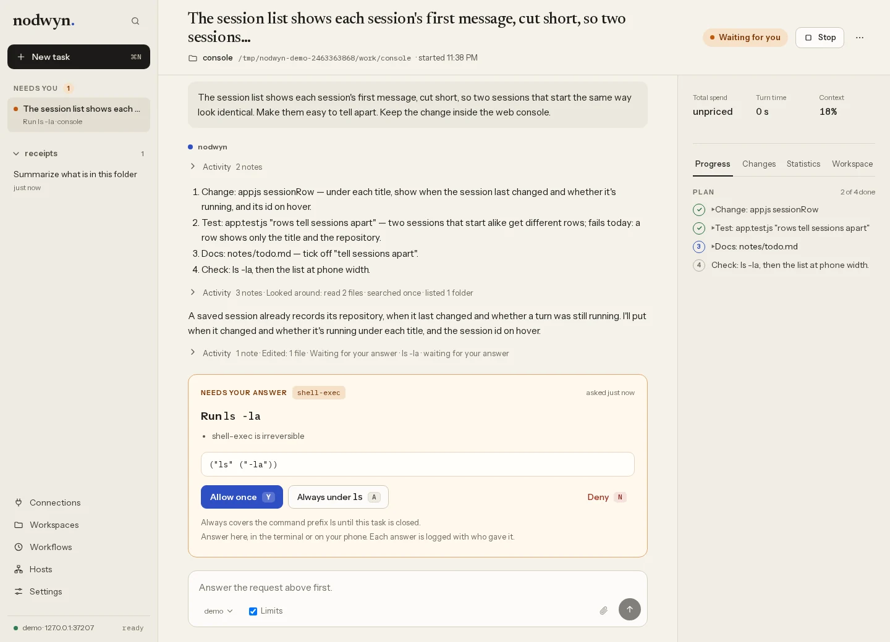

# nodwyn

nodwyn is a coding agent that I built around one worry: an agent that can run
commands and read files can also leak your keys. So the part that decides what
leaves your machine is small, written in Go, and doesn't trust the model.

<picture>
  <source media="(prefers-color-scheme: dark)" srcset="docs/images/task-dark.webp">
  
</picture>

The screenshot uses synthetic data. The task is waiting for permission to run
a command, with two of its four plan steps done.

The agent itself is a Scheme program running on a Go host. The loop, the
prompts, how it plans and when it asks you are all Scheme you can read and
change (a project can redefine them in `.nodwyn/init.scm`). Every way out of
Scheme into the host goes through one guard. Your API keys sit in an encrypted
keychain, and the model only ever holds an opaque handle to one. A key can be
used at the places you bound it to, and the host puts it in the request after
the model has finished writing it. So `sk-ant-...` going to the provider it
belongs to is fine, and the same bytes going anywhere else get refused.

It talks to Ollama, Anthropic and anything that speaks the OpenAI
chat-completions API. You can use it from a browser console, a native window, a
terminal UI, a plain line-mode chat, or scripts. It runs on Linux and macOS;
there's no Windows build yet. MCP servers can run in containers, which needs
podman or docker.

It's pre-1.0 and I use it every day, so expect rough edges. It isn't a sandbox:
commands you approve run with your user's privileges. The checks help catch
mistakes and leaks, but a determined program can get past them.
[docs/security.md](docs/security.md) explains those limits.

## Install

Releases are on the [GitHub Releases page](https://github.com/fclaude/nodwyn/releases).
Pick the archive for your system (Linux or macOS, amd64 or arm64), check it
against `SHA256SUMS`, and put `nodwyn` and `nodwyn-egress` next to each other
on your `PATH`. On a Mac, take the app instead, with its own window and
icon: `brew install --cask fclaude/fclaude-packages/nodwyn`, or
`Nodwyn-macos-universal.zip` from the release.
[docs/releases.md](docs/releases.md) has the details.

To build from source you need Go 1.26 or newer:

```sh
git clone https://github.com/fclaude/nodwyn
cd nodwyn
make build          # bin/nodwyn, and bin/nodwyn-egress
```

`go install github.com/fclaude/nodwyn/cmd/nodwyn@latest` gets you the binary
alone. That's fine unless you run MCP servers in containers, which also need
`nodwyn-egress`. The Scheme interpreter is a separate module,
[Brote](https://github.com/fclaude/brote), and Go fetches it like any other
dependency.

## First run

```sh
nodwyn app          # one program: a window, and a daemon if none is running
```

On a build without the native window (the portable release archives),
`nodwyn app` opens your browser instead. With no model set up yet, the first screen asks for
a provider and a model. Ollama needs no key. For one that does, nodwyn offers to
create the keychain and keeps the key there.

If you'd rather stay in the terminal:

```sh
nodwyn tui          # full-screen client
nodwyn              # plain chat in the current repository
```

For the terminal clients, set a control model in `~/.config/nodwyn/config.toml`.
This example needs Ollama running locally with `qwen3:8b` already pulled:

```toml
[control]
provider = "ollama"
url = "http://localhost:11434"
model = "qwen3:8b"
```

By default a write inside your repository goes ahead, with its diff logged and
the old contents kept so you can undo it. A command nothing has approved goes to
the judge if you've set one up (a second model that is only asked whether the
call should go ahead, see [the manual](docs/manual.md#the-judge)), and then to you. Anything that touches a
protected path, looks like a credential, or is built out of tool output always
asks. [The manual](docs/manual.md) covers approvals, budgets, workspaces, MCP
servers, workflows and the rest.

## Where things are

| Page | What it covers |
|---|---|
| [The website](https://nodwyn.com/) | A guide to the console, running it standalone and running it on a server, with screenshots; the reference below is on it too |
| [docs/manual.md](docs/manual.md) | How to use nodwyn, and how to read the code |
| [docs/reference.md](docs/reference.md) | Build and run commands, budgets, approvals and the clients in one page |
| [SPEC.md](SPEC.md) | The architecture and the invariants it keeps |
| [docs/adr/](docs/adr/) | The decisions, one file each, with why |
| [docs/scheme.md](docs/scheme.md) | The Scheme dialect the agent is written in |
| [docs/protocol.md](docs/protocol.md) | The JSON-RPC protocol the clients speak to the daemon |
| [plan.md](plan.md) | What's built and what comes next |
| [docs/friction.md](docs/friction.md) | Where nodwyn got in the way of building nodwyn |

There are also two books, a design book and *Becoming a nodwyn Expert*, built
from the sources in `docs/book` and `docs/expert`. Every release attaches the
PDFs.

## Contributing

Issues and pull requests are welcome, and an issue is also the place to ask a
question. [CONTRIBUTING.md](CONTRIBUTING.md) says how to build and what to run
before sending a change. To report a
security problem privately, see [SECURITY.md](SECURITY.md). Everyone taking part
follows the [code of conduct](CODE_OF_CONDUCT.md).

## Licence

Apache 2.0, in [LICENSE](LICENSE). [NOTICE](NOTICE) lists what comes from
others, and `nodwyn licenses` prints the licence of every library in the
binary.
